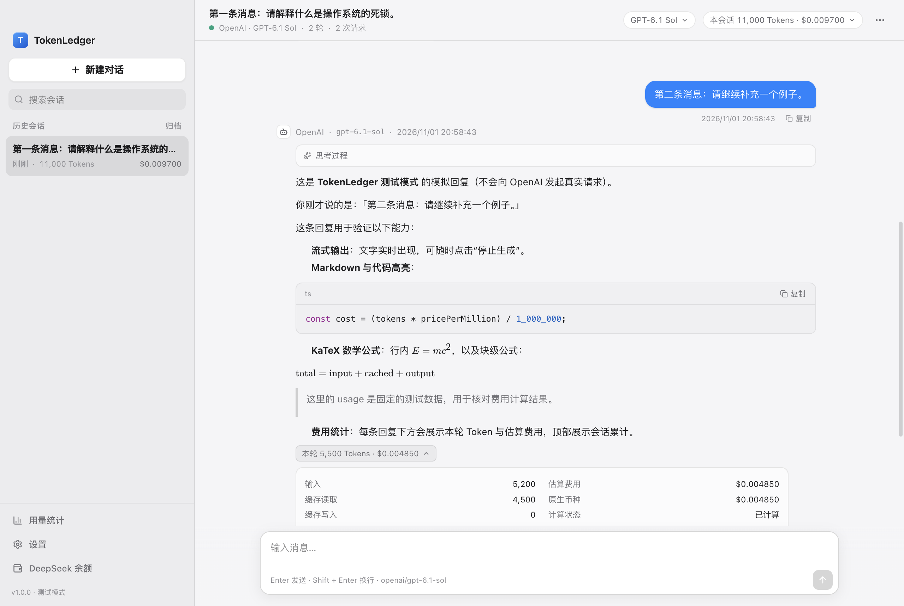
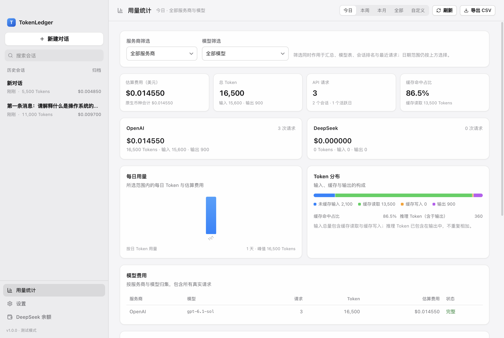
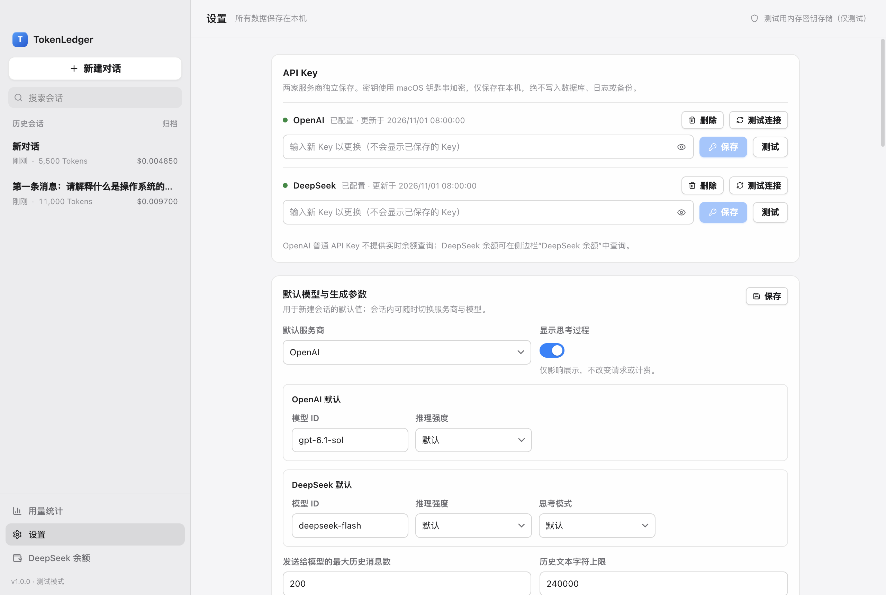
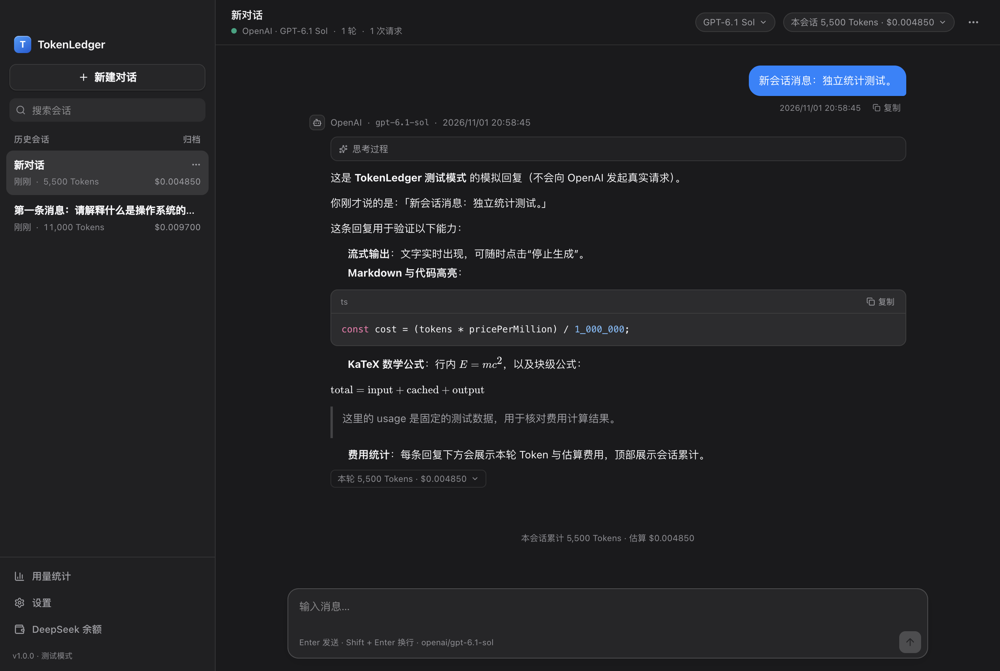
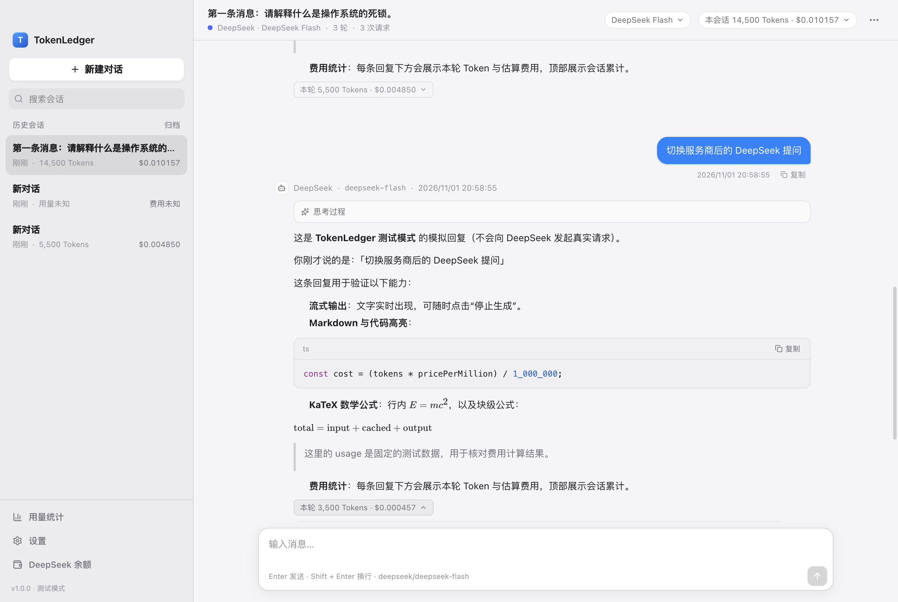

# TokenLedger

TokenLedger 是一款原生质感的 macOS AI 聊天客户端，支持 **OpenAI** 与 **DeepSeek** 官方 API，并在聊天过程中精确记录每一次真实请求的 Token 用量与估算费用。

它不是 Agent，也不做联网搜索或工具编排。它只做三件事：好好聊天、如实记账、把账本留在本机。



## 功能一览

- **双服务商**：OpenAI Responses API、DeepSeek Chat Completions，各自独立的 API Key。
- **流式聊天**：实时显示回答与 DeepSeek 思考内容，可随时停止、重新生成。
- **多轮上下文**：历史保存在本地 SQLite，切换服务商后仍可用本地消息继续对话。
- **三级统计**：
  - 每次 API 请求（含缓存命中、缓存写入、推理 Token、原始 usage、价格快照、请求 ID）；
  - 每一轮问答（同一轮的重试 / 重新生成都会累加，不抹除已发生费用）；
  - 每个完整会话（所有真实请求累计，支持同会话多模型、多服务商）；
  - 全局用量页（今日 / 本周 / 本月 / 全部 / 自定义日期，服务商、模型筛选）。
- **费用可追溯**：内置经核对的官方价格，每次请求写入不可变价格快照；支持用户覆盖单价、历史费用重算与核算日志。
- **DeepSeek 峰谷计价**：按北京时间工作日 09:00–12:00、14:00–18:00 判断高峰，含法定节假日日历与用户自定义；日历未覆盖时明确标记“费用未知”。
- **人民币 + 美元**：DeepSeek 费用先以 CNY 精确计算，再按有来源的汇率快照折算美元，并标注“估算”。
- **DeepSeek 余额**：调用官方 `/user/balance`，按返回币种展示，不做汇率混用；OpenAI 显示官方说明与 Billing 链接。
- **本地优先**：SQLite 保存在 macOS 标准应用数据目录，支持 Markdown / JSON / CSV 导出、全量备份与恢复。
- **安全**：API Key 由 Electron 45 异步 safeStorage（macOS 钥匙串）加密，不进入 SQLite、日志或备份；若钥匙串不可访问，可选用“仅本次运行”的内存密钥，绝不落盘。渲染进程无 Node 权限，严格 IPC 校验，Markdown 不执行脚本。
- **预算提醒**：单轮 / 单会话 / 每日 / 总额四档本地估算提醒，并明确标注其不确定性。

## 界面截图

| 聊天（浅色） | 用量统计 | 设置 |
| --- | --- | --- |
|  |  |  |

| 聊天（深色） | 同一会话混合服务商 |
| --- | --- |
|  |  |

> 截图使用内置测试模式的模拟数据，不包含真实 API Key、账号信息或真实聊天记录。

## 系统要求

- macOS 12 或更高版本（Apple Silicon 优先；本项目在 arm64 上完成构建与测试）
- Node.js 22+、npm
- 可访问 OpenAI / DeepSeek 官方 API 的网络

## 安装与启动

本仓库只包含源代码，**不包含** `node_modules/`、`dist/`、`release/` 或任何打包产物。请从源码运行：

```bash
npm install
npm run dev        # 开发模式（Vite HMR + Electron）
```

生产构建与启动：

```bash
npm run build
npm start          # 运行构建后的 dist
```

生成 Apple Silicon 应用（可选）：

```bash
npx electron-builder --mac --arm64
# 输出：release/mac-arm64/TokenLedger.app
```

> 首次安装会下载 Electron 二进制。网络受限时可设置 `ELECTRON_CACHE` 指向可写目录。

### 未签名与 Gatekeeper

本项目未启用 Apple Developer ID 签名或公证，公开仓库也不承诺提供签名安装包。如果你从其他方式取得了未签名 `TokenLedger.app`，首次打开可能被 Gatekeeper 拦截：

1. 在 Finder 中右键点击 App →「打开」→ 再次确认；或
2. 执行 `xattr -dr com.apple.quarantine /Applications/TokenLedger.app` 后重新打开。

上述操作只是绕过 macOS 对未签名应用的本地限制，不代表应用已被公证。

### 测试与类型检查

```bash
npm run typecheck
npm test
npm run build
npm run ui-test    # Electron + Playwright 真实窗口端到端测试（测试模式，不调用真实 API）
```

## 首次使用

1. 打开 TokenLedger，点击左下角「设置」。
2. 在 **API Key** 区域分别填写 OpenAI / DeepSeek Key（应用不会显示已保存的完整 Key）。
3. 点击「测试连接」。OpenAI 使用 `/v1/models`，DeepSeek 使用 `/models`，不会产生模型 Token 费用。
4. 回到聊天，点击顶部模型选择器，选择官方模型或手动输入模型 ID。
5. 输入消息并发送。回答会流式出现，底部显示本轮 Token 与估算费用，顶部显示会话累计。

所有 Key 默认只保存在本机 `secrets.json` 的 safeStorage 密文中；应用会做一次钥匙串加密/解密自检。如果系统钥匙串不可用，会显示明确原因，并提供“仅本次运行”模式：Key 只存在于主进程内存中，退出应用即失效，绝不写入磁盘。

## 服务商与模型

| | OpenAI | DeepSeek |
|---|---|---|
| 对话接口 | Responses API `/v1/responses` | Chat Completions `/chat/completions` |
| 流式 | 官方 SSE 事件（`response.completed` 取 usage） | `stream_options.include_usage = true` |
| 思考内容 | 推理摘要事件 | `reasoning_content` |
| 模型列表 | `/v1/models` + 手动 ID | `/models` + 手动 ID |
| 余额 | 普通 Key 无公开实时余额接口 | `/user/balance` |

- 未配置价格的模型仍可聊天，但费用会标记为 **“费用未知”**，不会被当作免费。
- 模型是否支持推理强度 / 思考模式由内置能力表与名称推断决定，不支持的参数不会被盲目发送。
- 会话内切换服务商后，请求仍使用本地可见消息作为上下文；两家服务的价格分别计算并汇总到同一会话。

## 费用统计的含义

### 1. 每次 API 请求

记录服务商、模型、开始/结束时间、状态、输入 / 未缓存输入 / 缓存读取 / 缓存写入（30 分钟、12 小时）/ 输出 / 推理 / 总 Token、原始 usage、规范化 usage、价格快照、估算费用（原生币种与 USD）、计算状态、请求 ID、错误详情。

### 2. 每一轮问答

一轮 = 一条用户消息 + 对应助手回复。若发生重试或重新生成，同一 Turn 下会有多次真实请求，**全部累加**，旧回复被标记 superseded，但其费用仍然保留。

### 3. 完整会话

会话累计始终是 **所有真实 API 请求的用量总和**，不是当前聊天文本自身的 Token 数。历史上下文每轮被重新发送所产生的输入 Token 会被如实计入。

### 4. 全局

全局统计包含已归档会话，以及被「从列表移除」的会话；只有用户明确执行「彻底删除」时，对应请求与费用才会被删除。删除前会二次确认。

> 费用是 **估算值**：根据官方 usage 与请求时价格快照计算，不代表服务商最终账单。普通 API 不会返回逐笔美元扣款。

### 金额精度

- 全程使用 `decimal.js`，金额以十进制字符串存储；
- 单轮默认显示 6 位小数；极小的非零费用自动扩展位数，**不会显示成 $0.000000**；
- 聚合基于未提前舍入的高精度值；
- 未知费用为 `null` + `calculation_status = unknown`，不参与金额求和，也不会变成 0。

## DeepSeek 峰谷与人民币 / 美元

- 官方规则（2026-11-01 核对）：北京时间 **周一至周五（不含法定节假日）09:00–12:00、14:00–18:00** 为高峰；其余时间为空闲时段，单价为高峰的 50%。
- 节假日日历内置 2025–2026 年国务院办公厅安排，可在设置中增删与延长覆盖范围。
- 超出日历覆盖范围时，默认将费用标记为 **未知**；只有用户显式允许后才按工作日规则 **估算**，并在计价依据中注明。
- DeepSeek 先按 **CNY** 计算；美元金额使用有来源的汇率快照折算，并显示 `≈`。默认种子来自 ECB 2026-10-30 参考汇率，可在设置中手动覆盖或点击「ECB」按钮在用户主动操作下更新。折算金额不代表官方美元扣款。

## 数据存储、备份与恢复

默认数据目录：

```
~/Library/Application Support/TokenLedger/
├── tokenledger.db      # SQLite（WAL）
├── secrets.json        # safeStorage 密文，权限 0600
├── backups/            # 恢复前自动快照 / 手动备份
└── logs/main.log       # 脱敏运行日志
```

- SQLite 开启 WAL、外键与忙等待；迁移通过 `schema_migrations` 版本化，升级不会重建或清空历史库。
- 备份为 JSON，包含聊天、消息、请求、价格快照、汇率、设置与节假日配置，**不包含 API Key**。
- 恢复会覆盖当前数据；应用会自动将当前库备份到 `backups/pre-restore-*.json`。备份文件中的表名、列名会经过白名单校验，防止注入。
- 导出：单个会话 Markdown / JSON，全局费用 CSV。

## 预算提醒

支持单轮 / 单会话 / 每日 / 总额四个可选上限。完成一次请求后，用本地累计估算值比较并弹出提醒。

- 未返回 usage 的请求无法计入；
- 本地估算可能低于服务商最终扣费；
- 这不是服务商侧的强制消费上限。

## 安全设计

- `contextIsolation: true`、`nodeIntegration: false`、`sandbox: true`，无 Node 能力暴露给页面；
- preload 仅暴露白名单 IPC 方法；主进程校验调用窗口、页面来源与每个参数；
- 渲染页面 CSP 禁止远程脚本与网络请求；Markdown 不启用原始 HTML，链接只允许 HTTPS 且需在官方域名白名单内，通过系统浏览器打开；
- API Key 不返回渲染进程；日志统一脱敏 `sk-*`、`Bearer`、`api_key`；
- 仅与用户选择的官方 AI 服务商通信；ECB 汇率仅在用户主动点击时请求；无遥测、广告或第三方上传。

## 常见问题

**Q：测试连接失败，提示 401？**
API Key 无效、过期或复制时多了空格。请重新粘贴并保存。

**Q：提示余额不足 / 402？**
DeepSeek 或 OpenAI 账户余额不足，请到官方控制台充值。应用不会自动重试以避免重复计费。

**Q：为什么费用显示“未知”？**
可能原因：服务商没有返回 usage（请求中断）、模型没有配置价格、usage 字段不完整、DeepSeek 请求落在节假日日历覆盖范围之外，或缺少必要的缓存价格。应用不会用 0 冒充未知。

**Q：DeepSeek 费用为什么是人民币？**
官方以人民币计价。应用先精确计算 CNY，再按汇率快照折算美元用于跨服务商汇总；两者都标注为估算。

**Q：重新生成会重复收费吗？**
会真实产生新的 API 请求，因此产生新费用。应用会如实累加，不会因回答被替换而抹掉旧请求费用。

**Q：重启后数据还在吗？**
在。聊天、请求、价格快照、会话累计都持久化在 SQLite 中。异常退出时，未完成的请求会在下次启动标记为“中断”，并保留已收到的部分文本与“用量未知”状态。

**Q：可以换电脑吗？**
使用「创建全量备份」，在另一台 Mac 上安装后「从备份恢复」。API Key 需要重新填写。

**Q：设置里提示“系统安全存储当前不可用”？**
通常是 macOS 钥匙串被锁定、拒绝访问，或运行在受限的自动化环境中。解锁钥匙串后重启应用即可正常保存；也可以使用“仅本次运行”，Key 只保存在内存中，不会落盘，退出后需重新输入。

**Q：为什么应用显示“未签名”？**
当前交付为未签名开发包，符合本地使用；正式分发需要 Apple Developer ID 签名与公证。

## 已知限制

- 仅构建/测试了 Apple Silicon（arm64）版本；未提供已签名安装包或 DMG。
- 未使用真实 API Key 进行付费调用验证；OpenAI / DeepSeek 的请求构造、SSE 解析与错误映射由 Mock HTTP 与集成测试覆盖，真实账号下的模型权限、地区限制与最终账单仍需用户自行核对。
- OpenAI 价格档位、缓存规则与 DeepSeek 峰谷/节假日规则可能随官方调整；应用内置价格版本为 `2026-11-01`，用户可在设置中覆盖并手动重算历史费用。
- 未集成 Apple 公证、自动更新与崩溃上报（刻意不做遥测）。
- 在本任务所在的受限自动化环境中，macOS 钥匙串加密自检失败，因此界面会进入“安全存储不可用”分支；该分支的会话密钥路径已由打包应用测试覆盖。真实桌面登录会话中的钥匙串保存行为需用户首次配置时确认。
- Code signing / notarization 不适用当前环境；产物未签名。

## 许可证

本仓库当前**未附带开源许可证**。公开仓库不等于授权任何人复制、修改或再分发代码；如需使用代码，请先联系作者。

## 技术栈

Electron 45 · React 19 · TypeScript 7（strict）· Vite 8 · Tailwind CSS 4 · SQLite（Node 内置 `node:sqlite`，避免原生模块重编译，主进程与测试使用同一引擎）· Zustand · decimal.js · react-markdown + KaTeX + highlight.js · Vitest 5 · Playwright（Electron 端到端）· electron-builder 26。

详细设计见 [ARCHITECTURE.md](ARCHITECTURE.md)，测试记录见 [TEST_REPORT.md](TEST_REPORT.md)，开发过程见 [PROGRESS.md](PROGRESS.md)。
